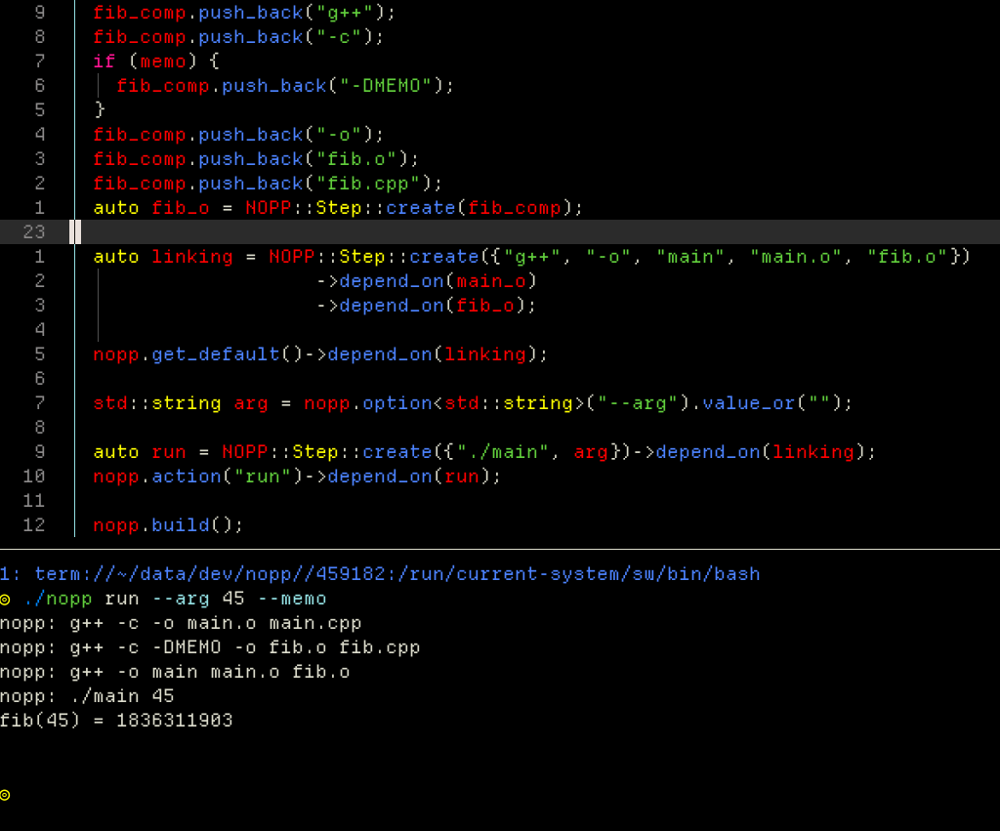

# NOPP.hpp
/noʊ piː piː/

Build system for C++ inspired by (and better than) zozin's [nob.h](https://github.com/tsoding/nob.h) and [Zig Build System](https://ziglang.org/learn/build-system/).

[example/](example/) uses +- every feature that is available.

[how_to/](how_to/) explains each feature

tl;dr; you build C++ with C++

